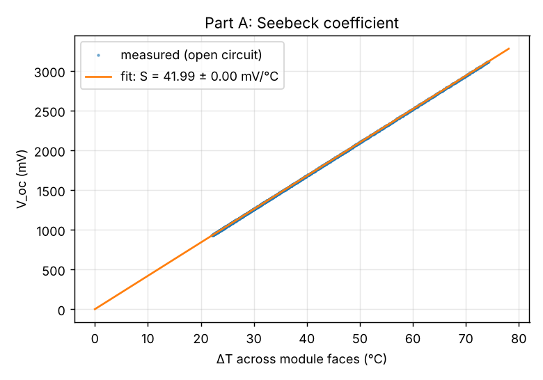
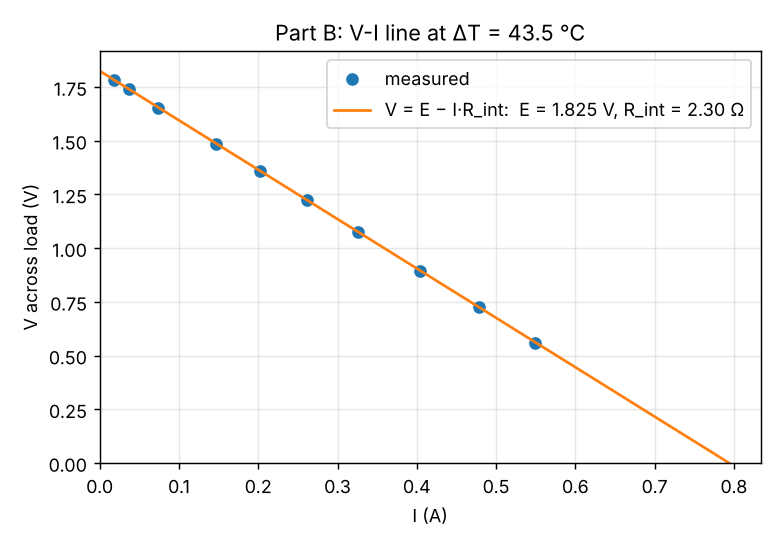
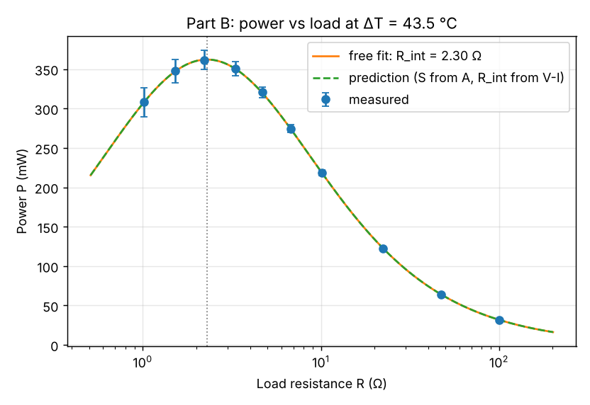
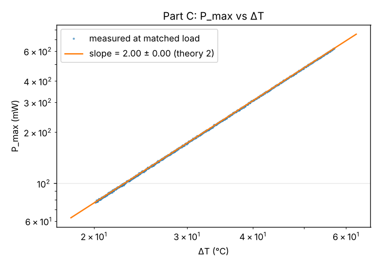

# Peltier module as a thermoelectric generator (TEG)

Characterising a TEC1-12706 Peltier module run backwards as a generator, and checking a simple circuit model of it against measurement.

> **Status (Oct 2026):** the hardware has not been built yet. The Arduino sketch has **not been compiled or run** on a board. The Python scripts have only been tested on **simulated** data. The numbers and graphs in this repo are from that simulation, not from an experiment.

## The problem

Can heat from a beaker of hot water power a small electrical load, and what is the most power this module can deliver?

The experiment measures three things from two sets of data and checks them against each other:

1. **Seebeck coefficient S** from open-circuit voltage vs temperature difference (Part A).
2. **EMF E and internal resistance R_int** from the V-I line of a load sweep (Part B).
3. **Maximum power P_max**, verifying the Maximum Power Transfer Theorem (peak at R_load = R_int) and that P_max ∝ ΔT² (Parts B and C).

The power curve P(R) is then **predicted with zero fitted parameters** from S (Part A) and R_int (Part B) and compared with the measured power. This is the simulation-vs-measurement comparison the course asks for under CO4.

## The physics

**Seebeck effect.** A temperature difference across a thermoelectric junction produces an EMF E = S·ΔT. The module has N = 127 bismuth telluride p-n couples in series, each giving about 400 µV/K, so the module's S is around 40-50 mV/K, over 1000 times a copper-constantan thermocouple.

**Equivalent circuit.** As a generator, the module is an EMF in series with an internal resistance (about 2-3 Ω):

```
E = S·ΔT        I = E / (R + R_int)        V = E − I·R_int        P = E²R / (R + R_int)²
```

**Maximum power transfer.** P is largest when R = R_int, giving P_max = E²/4R_int = S²ΔT²/4R_int. So doubling ΔT gives four times the power.

**Peltier effect.** When current flows, the module also pumps heat from the hot face to the cold face (Π = S·T), so ΔT drops a little under load.

**Efficiency.** With ZT ≈ 0.7 and ΔT ≈ 40 K, the module converts about 2% of the heat flowing through it, against a Carnot limit of about 12%.

The full derivations are in [docs/extended-notes.md](docs/extended-notes.md#theory).

## Repository layout

| Path | What it is |
| --- | --- |
| [`firmware/teg_logger/teg_logger.ino`](firmware/teg_logger/teg_logger.ino) | Arduino Uno sketch: reads two DS18B20s and the ADS1115, shows live values on the LCD, prints CSV over Serial, takes typed commands |
| [`python/teg_logger.py`](python/teg_logger.py) | Saves the Arduino's Serial output to a CSV file and forwards typed commands |
| [`python/teg_analysis.py`](python/teg_analysis.py) | Fits S, E and R_int, predicts P(R), checks the ΔT² law, estimates efficiency, draws four graphs |
| [`demo_output_SIMULATED/`](demo_output_SIMULATED/) | Output of `teg_analysis.py --demo`. **Simulated data, not a measurement** |
| [`docs/lab-manual.md`](docs/lab-manual.md) | Lab manual in the RVCE format (aim, principle, procedure, tables, calculations, result) |
| [`docs/extended-notes.md`](docs/extended-notes.md) | Longer theory, wiring, step-by-step procedure, error analysis, viva questions |
| [`docs/future-work.md`](docs/future-work.md) | Ideas from recent research to try after the PBL |
| [`3d-model/index.html`](3d-model/index.html) | Interactive 3D model of the bench setup (open in a browser; needs internet for three.js) |

## Hardware and wiring

| Part | Notes |
| --- | --- |
| Peltier module TEC1-12706 | 40×40 mm, 127 couples |
| Arduino Uno R3 | USB to laptop, 115200 baud |
| ADS1115 16-bit ADC | I2C address 0x48 (ADDR to GND), differential input A0−A1 |
| 20×4 LCD with I2C backpack | Address 0x27 (some boards use 0x3F; change `LCD_ADDR`) |
| 2× DS18B20 temperature sensors | On D2 with a 4.7 kΩ pull-up to 5 V; an optional 3rd in the hot bath is logged as T_bath |
| Load resistors | 1, 2.2, 3.3, 4.7, 6.8, 10, 22, 47, 100 Ω; at least 1 W below 10 Ω |
| Two aluminium plates, thermal paste, tape | Hot side in a hot water bath (80-95 °C), cold side on ice water |

**Stack, bottom to top:** hot water → aluminium plate (hot sensor beside the module) → paste → Peltier module → paste → aluminium plate (cold sensor beside the module) → ice water. Clamp lightly and evenly. The sensors go on the plates right next to the module, never in the water.

| From | To | Note |
| --- | --- | --- |
| ADS1115 VDD, GND | Uno 5V, GND | ADDR to GND |
| ADS1115 SDA, SCL | Uno A4, A5 | Shared with the LCD backpack |
| ADS1115 A0 | Top of the load resistor (TEG +) | Short wire or screw terminal |
| ADS1115 A1 | Bottom of the load resistor (TEG −) | Also joined to GND at one point |
| DS18B20 data (all) | Uno D2 | 4.7 kΩ from D2 to 5 V |
| DS18B20 VDD, GND | Uno 5V, GND | Normal (not parasite) power |

**Before connecting A0**, check with a multimeter that the module's output is positive on the A0 wire when the hot side is hot. An input below −0.3 V can damage the ADS1115. Low-value loads carry up to 0.6 A, so use a terminal block, not a breadboard.

## Required libraries

**Arduino** (Arduino IDE → Library Manager):

- OneWire
- DallasTemperature
- Adafruit ADS1X15
- LiquidCrystal I2C (by Frank de Brabander)

`Wire` and `EEPROM` come with the Arduino IDE.

**Python 3** (`pip install -r requirements.txt`): numpy, scipy, matplotlib, pyserial.

## How to run

### 1. Upload the sketch

Open `firmware/teg_logger/teg_logger.ino` in the Arduino IDE, select Arduino Uno and the right port, and upload. Open the Serial Monitor at 115200 baud to check that it prints `# sensors=2 ...` and a CSV header. If it says the ADS1115 or the sensors were not found, check the wiring.

Commands (type in the Serial Monitor or in `teg_logger.py`, then Enter):

| Command | Meaning |
| --- | --- |
| `R <ohms>` | The load you just connected (`R 0` = open circuit) |
| `C` | Calibrate: put both sensors in the same water first |
| `Z` | Clear the calibration offset |
| `X` | Swap which sensor is hot and which is cold |
| `P <sec>` | Logging period in seconds (minimum 1) |
| `N <text>` | Write a note into the log |
| `?` | Show status |

### 2. Log each part to a CSV file

Close the Serial Monitor first (only one program can use the port), then:

```
python python/teg_logger.py --port COM3 --out partA.csv            # Windows
python python/teg_logger.py --port /dev/ttyACM0 --out partA.csv    # Linux / Mac
```

Do the same for `partB.csv` and `partC.csv`. What to do during each part is in [docs/lab-manual.md](docs/lab-manual.md#procedure) and, in more detail, [docs/extended-notes.md](docs/extended-notes.md#procedure).

### 3. Analyse

```
python python/teg_analysis.py --a partA.csv --b partB.csv --c partC.csv
```

This writes `fig1_seebeck.png`, `fig2_VI.png`, `fig3_power.png`, `fig4_dT2.png` and `results.txt` to `teg_results/`. Run `python python/teg_analysis.py --help` for options such as `--settle`, `--N`, `--bath-mass` and `--K`.

To try the analysis without any hardware:

```
python python/teg_analysis.py --demo
```

## Demo results (simulated)

**These graphs come from simulated data generated by `teg_analysis.py --demo`, not from a real experiment.** The simulation is built from the same model the script fits, so the agreement is unrealistically good. See [demo_output_SIMULATED/README.md](demo_output_SIMULATED/README.md).

| | |
| --- | --- |
|  <br> *Simulated. V_oc vs ΔT; slope S = 41.99 mV/°C* |  <br> *Simulated. V vs I; E = 1.825 V, R_int = 2.30 Ω* |
|  <br> *Simulated. P vs R; peak 362 mW at R ≈ R_int* |  <br> *Simulated. log-log slope 2.000 (theory 2)* |

## Known limitations

- **The Arduino sketch has not been compiled yet.** It was written without access to the Arduino toolchain, so expect possible compile errors or library-version differences the first time it is built. Please report or fix anything that comes up.
- The Python scripts have been run only on simulated data. `teg_logger.py` has not been tested with a real serial port.
- ΔT is measured on the module's outer faces, so S and P_max will come out lower than the true values across the thermoelectric legs (see the error analysis in [docs/extended-notes.md](docs/extended-notes.md#error-analysis)).
- Component prices in the lab manual are rough estimates, not quotes.

## Future work

After the PBL, the plan is to try a thermal paste test (dry vs paste, using a third sensor in the bath) and to show the Peltier back-action under load. Details and references are in [docs/future-work.md](docs/future-work.md).

